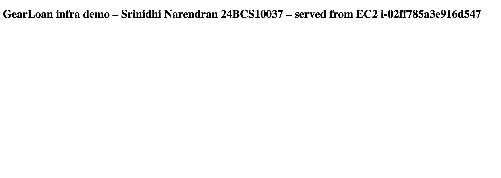

# Session 19 – Cloud & Terraform in Action

**Name:** Srinidhi Narendran · **Roll No:** 24BCS10037 · **Batch:** B

An end-to-end AWS setup built only with Terraform: a VPC, a public subnet, a security group, an EC2 web server and an S3 bucket. The EC2 instance serves a web page, and it is allowed to read only that one bucket. I applied it on my AWS account (`ap-south-1`), tested it, and destroyed it.

- Terraform project: [`terraform/`](terraform/)
- Full real output (init, plan, apply, checks, destroy): [`outputs/terraform-run.txt`](outputs/terraform-run.txt)

## Architecture

```text
                         Internet
                            │  HTTP :80
                            ▼
 ┌────────────────── VPC gearloan-s19-vpc 10.20.0.0/16 (ap-south-1) ─────────────────┐
 │   Internet Gateway ◄── route table: 0.0.0.0/0 → igw                                │
 │                                                                                    │
 │   ┌────────── public subnet 10.20.1.0/24 (ap-south-1a) ──────────┐                 │
 │   │   Security group: allow TCP 80 from anywhere, no SSH          │                │
 │   │   ┌────────────────────────────────────────────┐            │                 │
 │   │   │ EC2 t3.micro (Amazon Linux 2023, IMDSv2)   │            │                 │
 │   │   │ nginx → "GearLoan infra demo" page          │            │                 │
 │   │   │ IAM instance profile ──────────────────────┼────────────┼──┐              │
 │   │   └────────────────────────────────────────────┘            │  │              │
 │   └──────────────────────────────────────────────────────────────┘  │              │
 └─────────────────────────────────────────────────────────────────────┼──────────────┘
                                                                       │ s3:ListBucket, s3:GetObject (only)
                                                                       ▼
                                   S3 bucket srinidhi-24bcs10037-s19-assets-*  (private, versioned, SSE-S3)
```

## What each Terraform concept looks like here

| Concept | Where |
|---|---|
| **Providers** | [`providers.tf`](terraform/providers.tf): `hashicorp/aws ~> 6.69`, `hashicorp/random ~> 3.9`, `default_tags` so every resource gets `Project`, `Owner`, `ManagedBy` |
| **Variables** | [`variables.tf`](terraform/variables.tf): region, project name, instance type, VPC and subnet CIDRs, optional `admin_cidr` (empty = no SSH rule, made with a `dynamic` block). Example values in [`terraform.tfvars.example`](terraform/terraform.tfvars.example) |
| **Resources** | [`network.tf`](terraform/network.tf) (VPC, subnet, IGW, route table + association, SG), [`compute.tf`](terraform/compute.tf) (EC2 + [`user_data.sh`](terraform/user_data.sh)), [`storage.tf`](terraform/storage.tf) (S3 + settings), [`iam.tf`](terraform/iam.tf) (role, least-privilege policy, instance profile) |
| **Data sources** | latest Amazon Linux 2023 AMI from the SSM parameter `/aws/service/ami-amazon-linux-latest/al2023-ami-kernel-default-x86_64`; IAM policy documents |
| **Outputs** | [`outputs.tf`](terraform/outputs.tf): `public_ip`, `website_url`, `instance_id`, `vpc_id`, `subnet_id`, `bucket_name`, `security_group_id` |
| **Dependencies** | mostly **implicit** (e.g. the subnet uses `aws_vpc.main.id`, so it waits for the VPC). Plus an **explicit** `depends_on` so the EC2 starts only after the route table association and the IAM policy exist; otherwise the boot script could run before there's internet access |
| **State** | local `terraform.tfstate`, gitignored. `terraform state list` showed 20 entries: the 16 resources + 4 data sources |

Part of the dependency graph (`terraform graph`):
```text
"aws_instance.web" -> "aws_route_table_association.public";
"aws_instance.web" -> "aws_security_group.web";
"aws_instance.web" -> "aws_iam_instance_profile.web";
"aws_instance.web" -> "aws_iam_role_policy.read_assets";
"aws_instance.web" -> "data.aws_ssm_parameter.al2023";
"aws_iam_instance_profile.web" -> "aws_iam_role.web";
"data.aws_iam_policy_document.read_assets" -> "aws_s3_bucket.assets";
"aws_internet_gateway.main" -> "aws_vpc.main";
```

## The run

```bash
cd terraform
export AWS_PROFILE=devops-lab
cp terraform.tfvars.example terraform.tfvars
terraform init && terraform fmt -check -recursive && terraform validate
terraform plan -out=tfplan
terraform apply tfplan
```

**plan** → `Plan: 16 to add, 0 to change, 0 to destroy.`

**apply**: Terraform created the resources in dependency order:
```text
aws_vpc.main                 4s
aws_s3_bucket.assets         5s
aws_internet_gateway.main    1s
aws_security_group.web       4s
aws_subnet.public           12s
aws_route_table_association.public  1s
aws_instance.web            16s      <- last, after its depends_on
Apply complete! Resources: 16 added, 0 changed, 0 destroyed.

bucket_name = "srinidhi-24bcs10037-s19-assets-f9ea0ac3"
instance_id = "i-02ff785a3e916d547"
public_ip = "35.154.177.7"
security_group_id = "sg-0cbdf1391963fe351"
subnet_id = "subnet-04d0e22cbbeb1001d"
vpc_id = "vpc-0a011aca7565797f7"
website_url = "http://35.154.177.7"
```

## Checking it worked

**The web page** (nginx installed by `user_data`, live about 15 s after apply):
```text
$ curl -i http://35.154.177.7
HTTP/1.1 200 OK
Server: nginx/1.30.5
...
<title>GearLoan infra demo</title>
```


**The AWS resources** (AWS CLI):
```text
EC2:  i-02ff785a3e916d547  t3.micro  running  ap-south-1a  public 35.154.177.7  private 10.20.1.160
      IMDSv2 = required, instance profile = gearloan-s19-web-profile
VPC:  vpc-0a011aca7565797f7  10.20.0.0/16  gearloan-s19-vpc
Subnet: subnet-04d0e22cbbeb1001d  10.20.1.0/24  ap-south-1a  PublicIpOnLaunch = True
Security group inbound: tcp 80 from 0.0.0.0/0   (nothing else, no SSH)
Routes: 10.20.0.0/16 -> local,  0.0.0.0/0 -> igw-0c816d75c710b2b0e
S3:   assets/readme.txt uploaded, versioning Enabled
```
**Least privilege:** the role's inline policy only allows reading this one bucket:
```json
{ "Action": "s3:ListBucket", "Resource": "arn:aws:s3:::srinidhi-24bcs10037-s19-assets-f9ea0ac3" },
{ "Action": "s3:GetObject",  "Resource": "arn:aws:s3:::srinidhi-24bcs10037-s19-assets-f9ea0ac3/*" }
```

## Destroy
```text
$ terraform destroy -auto-approve
...
aws_vpc.main: Destruction complete after 1s
Destroy complete! Resources: 16 destroyed.

$ terraform state list | wc -l
       0
(no s19 instance, VPC, bucket or Elastic IP left)
$ curl http://35.154.177.7
35.154.177.7 no longer answers
```
The infrastructure was up for about 6 minutes (≈ a few cents for the t3.micro, its public IP and storage).

## Security choices
- No SSH and no key pair. Port 22 is only opened if `admin_cidr` is set to one IP.
- IMDSv2 is required, which stops a common SSRF trick against the metadata service.
- Encrypted gp3 root disk; the S3 bucket is private, versioned and encrypted.
- The instance gets temporary credentials from its IAM role. No access keys are stored on it.
