# GearLoan – Final DevOps Capstone

**Name:** Srinidhi Narendran · **Roll No:** 24BCS10037 · **Batch:** B · **Repo:** https://github.com/citruswhale/Shell_Scripting_Basics

GearLoan is a small web app for a college club or lab that lends out equipment: cameras, laptops, microphones, lights, tripods. You can add gear, lend it to someone with a due date, see what is overdue, and mark it returned.

The app is the base. The point of the project is the **DevOps around it**: tests, containers, a CI/CD pipeline with security gates, images in GHCR, AWS infrastructure built with Terraform, Kubernetes with Helm, GitOps with Argo CD, and monitoring with Prometheus and Grafana.

> **Original domain.** GearLoan is my own idea (equipment lending with loan rules). It is not the TaskBoard example from the course. Only the DevOps layout follows the course structure. See [`../SOURCES.md`](../SOURCES.md).

---

## 1. What the app does

| Feature | Rules |
|---|---|
| Equipment (items) | name 2–100 chars, category (`camera`, `laptop`, `audio`, `lighting`, `tripod`, `other`), unique serial number, condition (`good` / `fair` / `damaged`), status (`available` / `on_loan` / `maintenance`) |
| Lend an item | only if it is `available`. Due date must be today or within 30 days. Email is validated. One person can have **at most 3** open loans |
| Return | marks the loan `returned` and the item `available` again, or `maintenance` if it came back `damaged` |
| Overdue | an open loan past its due date shows as `overdue` |
| Delete | an item with an open loan can't be deleted (`409`); a loan can only be deleted after it's returned |
| Search / filter | items by text, category and status; loans by `active` / `overdue` / `returned` and borrower email |
| Stats | totals for the summary cards |

### REST API (FastAPI, all under `/api`)
| Method | Path | Notes |
|---|---|---|
| GET | `/api/items?search=&category=&status=` | list + filters |
| GET | `/api/items/{id}` | 404 if missing |
| POST | `/api/items` | 201, 422 on bad input, 409 on duplicate serial |
| PUT | `/api/items/{id}` | partial update |
| DELETE | `/api/items/{id}` | 204, or 409 if it is on loan |
| GET | `/api/loans?status=&borrower_email=` | list + filters |
| GET | `/api/loans/{id}` | |
| POST | `/api/loans` | lend (all the business rules above) |
| POST | `/api/loans/{id}/return` | return, with an optional `condition` |
| DELETE | `/api/loans/{id}` | only returned loans |
| GET | `/api/stats`, `/api/info` | summary numbers; app name + version |
| GET | `/health` | liveness, no DB call |
| GET | `/ready` | readiness: runs `SELECT 1`, 503 if the DB is down |
| GET | `/metrics` | Prometheus format |

### Screens
| Desktop | Phone (390 px) |
|---|---|
| 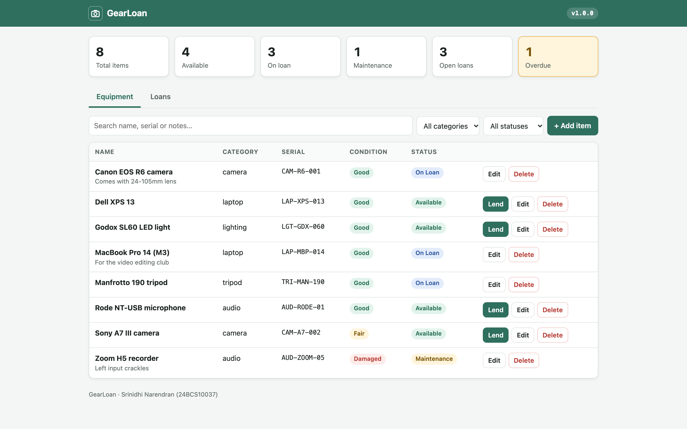 | 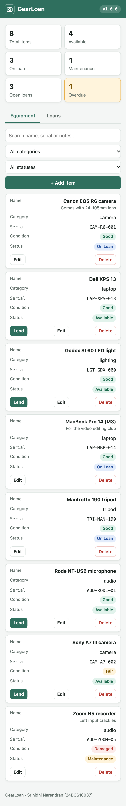 |

A full browser run (add → validation error → search → filter → edit → lend → loan filters → return → reload → delete) is in [`evidence/browser-test/`](evidence/browser-test/), with [screenshots](evidence/browser-test/) and the [step log](evidence/browser-test/browser-test-output.txt).

---

## 2. Architecture

```text
 Developer ── git push ──► GitHub (citruswhale/Shell_Scripting_Basics, branch master)
                              │
                              ▼
               GitHub Actions: capstone-ci-cd.yml
   tests ─ frontend build ─ Bandit ─ pip-audit/npm audit ─ Gitleaks ─ helm/terraform checks
                              │
                 docker build (backend, frontend) → Trivy gate → kind deploy test
                              │
                 push to GHCR  ghcr.io/citruswhale/gearloan-{backend,frontend}:<git sha>
                              │
                 bot commit: new tag in helm/gearloan/values-eks.yaml
                              │
                              ▼  (pull)
   ┌──────────────────────── AWS ap-south-1 (Terraform) ───────────────────────────┐
   │ VPC 10.30.0.0/16 · 2 public subnets in 2 AZs · Internet Gateway (no NAT)       │
   │ ┌──────────────────────── EKS 1.37, 2 × m7i-flex.large ─────────────────────┐  │
   │ │ Argo CD ── syncs Helm chart ──► namespace gearloan                        │  │
   │ │                                                                           │  │
   │ │  ingress-nginx (node IP:30080) ── / ──► frontend Service ──► 2+ nginx Pods│  │
   │ │                          └─ /api  ──► backend Service ──► 2+ FastAPI Pods │  │
   │ │                                                       └─► PostgreSQL     │  │
   │ │                                                         (StatefulSet+EBS)│  │
   │ │  HPA (CPU 70%) on both · ConfigMap · Secret · probes · limits             │  │
   │ │  kube-prometheus-stack: Prometheus ◄─ ServiceMonitor (/metrics), Grafana  │  │
   │ └───────────────────────────────────────────────────────────────────────────┘  │
   └────────────────────────────────────────────────────────────────────────────────┘
```

## 3. Tech stack

| Layer | Tools |
|---|---|
| Backend | Python 3.12, FastAPI 0.143, SQLAlchemy 2.1, Pydantic 2, Alembic 1.20, psycopg 3, prometheus-client |
| Frontend | React 18, Vite 8, served by `nginx-unprivileged` (proxies `/api`) |
| Database | PostgreSQL 17 |
| Tests | pytest (28 tests), separate Postgres test database |
| Containers | Docker, multi-stage builds, non-root users, Docker Compose |
| CI/CD | GitHub Actions, GHCR, kind (test deploy), GitOps tag update |
| Security | Bandit (SAST), pip-audit + npm audit (SCA), Gitleaks (secrets), Trivy (images) |
| Infrastructure | Terraform 1.16 (AWS provider 6.69, `terraform-aws-modules` vpc + eks), AWS VPC + EKS + EBS CSI |
| Kubernetes | Helm 4 chart, ingress-nginx, HPA, metrics-server, Argo CD 3.5 |
| Observability | kube-prometheus-stack (Prometheus, Alertmanager, Grafana 13) |

## 4. Folder structure
```text
session21-python/
├── backend/              FastAPI app, Alembic, tests, Dockerfile
│   ├── app/              main.py, config.py, database.py, models.py, schemas.py, metrics.py, routers/
│   ├── alembic/versions/ 0001_initial.py
│   ├── tests/            conftest.py + 28 tests
│   └── requirements.txt  pinned
├── frontend/             React + Vite, nginx template, multi-stage Dockerfile
├── docker-compose.yml    postgres + backend + frontend   (docker-compose.test.yml = test DB)
├── helm/gearloan/        Chart.yaml, values*.yaml, templates/
├── k8s/                  namespace.yaml, bootstrap/ (gp3 StorageClass), argocd/application.yaml
├── terraform/            VPC + EKS (vpc.tf, eks.tf, variables.tf, outputs.tf, terraform.tfvars.example)
├── monitoring/           kube-prometheus-stack values, alert rules, Grafana dashboard, traffic generator
├── security/             trivy.yaml, bandit.yaml (used by CI)
├── evidence/             real outputs and screenshots from my runs
└── demo/                 slides + presentation video
```

---

## 5. Run it locally (Docker Compose)

```bash
cd session21-python
cp .env.example .env          # set POSTGRES_PASSWORD (compose refuses to start without it)
docker compose up --build -d --wait
open http://localhost:3000    # app (frontend proxies /api to the backend)
curl http://localhost:8000/metrics
docker compose down           # stop (add -v to also delete the database volume)
```
[Real output](evidence/local/compose-up.txt) from `docker compose up --build`:
```text
gearloan-backend-1    gearloan-backend:local    "./entrypoint.sh"   Up 10 seconds (healthy)   0.0.0.0:8000->8000/tcp
gearloan-frontend-1   gearloan-frontend:local   "/docker-entrypoint.…"   Up 5 seconds (healthy)   0.0.0.0:3000->8080/tcp
gearloan-postgres-1   postgres:17-alpine        "docker-entrypoint.s…"   Up 16 seconds (healthy)  5432/tcp
$ docker compose exec backend id   -> uid=10001(gearloan)
$ docker compose exec frontend id  -> uid=101(nginx)
```
- The backend waits for Postgres to be healthy, and the frontend waits for the backend's `/ready`. That avoids nginx starting before its upstream exists.
- Both images run as **non-root**: the backend as user `10001`, the frontend on `nginx-unprivileged` (uid 101, port 8080).
- The frontend Dockerfile is **multi-stage**: `node:24-alpine` runs `npm ci && npm run build`, then only the built `dist/` is copied into `nginx-unprivileged:1.30-alpine`.

## 6. Tests

```bash
docker compose -f docker-compose.test.yml up -d --wait        # Postgres test DB on :5433 (db gearloan_test)
cd backend && python3.12 -m venv .venv && .venv/bin/pip install -r requirements-dev.txt
.venv/bin/pytest -v
```
- **28 tests** across `/health`, `/ready`, `/metrics`, `/api/info`, `/api/items`, `/api/loans`, `/api/stats` and the migration. They cover happy paths, 422 validation, 404s, every 409 business rule, the return flow, damaged → maintenance, overdue detection, filters, persistence across sessions, `/ready` returning 503 when the DB is down, and a check that the models match the migration.
- **Isolated test database:** `conftest.py` reads `TEST_DATABASE_URL`, **refuses any database whose name doesn't contain `test`**, builds the schema with Alembic (downgrade to base → upgrade to head), and empties the tables between tests. The app database is never touched.
- `pytest.ini` + `conftest.py` are in [`backend/`](backend/).

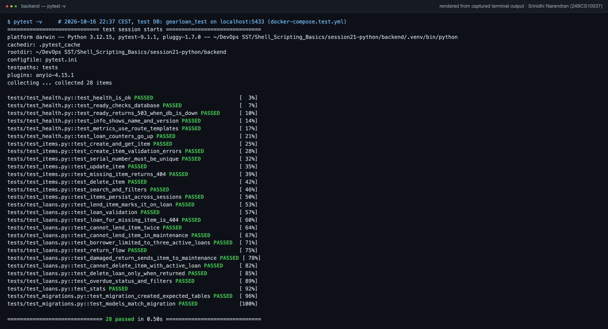

---

## 7. CI/CD pipeline – [`.github/workflows/capstone-ci-cd.yml`](../.github/workflows/capstone-ci-cd.yml)

Triggered on **push to `main` or `master`** (this repo's branch is `master`) when `session21-python/**` changes, or by hand (`workflow_dispatch`).

```text
 meta ─────────────────────────────────────────────────────────────────┐
 backend-test (pytest + Postgres service) ─┬─► docker-build ─► image-scan ─┐
 frontend-build (npm ci + vite build) ─────┘   (backend, frontend) (Trivy)  │
 sast (Bandit) ─ sca (pip-audit, npm audit) ─ secret-scan (Gitleaks) ─ iac-validate (helm lint/template, terraform fmt/validate)
                                                                            ▼
                                          security-gate ─► deploy-test (kind + Helm + smoke test)
                                                                            ▼
                                       push (GHCR, :<sha>) ─► gitops-update (values-eks.yaml)
```

| Rubric item | How |
|---|---|
| pytest fails the build | `backend-test` runs `pytest -v` against a `postgres:17-alpine` service. Everything after it `needs:` it |
| Frontend built | `npm ci` (from `package-lock.json`) + `npm run build`, `dist/` uploaded as an artifact |
| Both images built | matrix `docker-build` for backend and frontend, `linux/amd64` (EKS nodes are x86) |
| Pushed to GHCR | `ghcr.io/citruswhale/gearloan-backend` and `gearloan-frontend`, logged in with `GITHUB_TOKEN` |
| SHA tags | the full commit SHA + the short SHA (`latest` is also pushed, but deployments always use the SHA) |
| Same image tested and shipped | each image is built once to a tarball → scanned → deployed in kind → **that same tarball** is pushed |
| Deployment | `gitops-update` writes the new SHA into `helm/gearloan/values-eks.yaml` (bot commit `ci: deploy gearloan <sha> [skip ci]`), and Argo CD on EKS syncs it |

**Green run:** https://github.com/citruswhale/Shell_Scripting_Basics/actions/runs/38964516947 (commit `22d5492`, 15 jobs, 5m 4s). [Log excerpt](evidence/ci/github-actions-run-38964516947.txt)

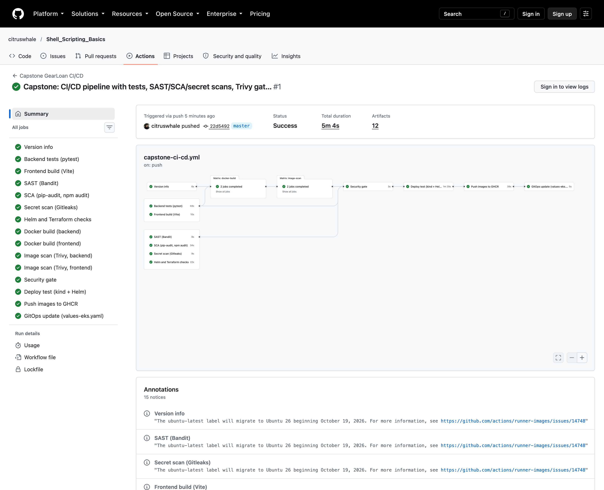

**GHCR images with SHA tags:**
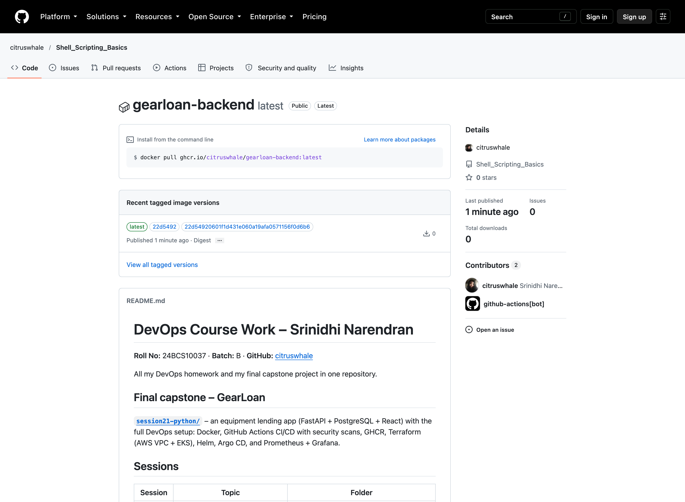

## 8. DevSecOps – Trivy and other gates

| Gate | Tool | Fails on | Result in run 38964516947 |
|---|---|---|---|
| SAST | Bandit on `backend/app` | any issue | `No issues identified.` |
| SCA | pip-audit `--strict`, `npm audit --omit=dev --audit-level=high` | any known vuln / HIGH+ | `No known vulnerabilities found`, `found 0 vulnerabilities` |
| Secrets | Gitleaks 8.30.1, whole Git history | any leak | `no leaks found` |
| **Image scan** | **Trivy 0.76.0 on both images** ([`security/trivy.yaml`](security/trivy.yaml)) | **HIGH or CRITICAL** with a fix available (`exit-code: 1`) | backend (Debian 13.7): **0**; frontend (Alpine 3.24.2): **0** |

**What Trivy scanned and what the result means:** Trivy looked inside both final images: the OS packages (Debian 13.7 for the backend, Alpine 3.24.2 for the frontend) and every installed Python/Node package. It checked them against known CVEs. It found no HIGH or CRITICAL vulnerability that has a fixed version available, so the gate passed and the images were allowed to ship. `ignore-unfixed` is on because a few Debian CVEs have no fix released yet, and there's nothing to upgrade to. A clean scan doesn't mean "perfectly secure": it only knows published CVEs on that day and doesn't test my own logic. That's why the scan runs on every push.

---

## 9. Infrastructure – Terraform ([`terraform/`](terraform/))

| Resource | Setting |
|---|---|
| Region | `ap-south-1` (Mumbai) |
| VPC | `gearloan-vpc`, `10.30.0.0/16` |
| Subnets | **2 public subnets** in 2 AZs (`10.30.1.0/24`, `10.30.2.0/24`), tagged `kubernetes.io/role/elb=1` |
| NAT | **none**, to keep the cost down (nodes are in public subnets with public IPs) |
| EKS | `gearloan-eks`, Kubernetes **1.37**, public endpoint, my IAM user gets admin through an access entry |
| Node group | **2 × m7i-flex.large** (2 vCPU, 8 GiB, x86; min 2 / max 3), AL2023, 20 GB gp3. I planned t3.medium, but my AWS account is on the Free plan, which only allows free-tier types, so the first node group never started |
| Add-ons | vpc-cni, kube-proxy, coredns, eks-pod-identity-agent, **aws-ebs-csi-driver** (own IAM role via Pod Identity) |
| Modules | `terraform-aws-modules/vpc` 6.7.3, `terraform-aws-modules/eks` 21.29.0, AWS provider 6.69 |
| State | local (not committed: `.gitignore` covers `*.tfstate*`, `.terraform/`, `*.tfvars`) |
| Example vars | [`terraform.tfvars.example`](terraform/terraform.tfvars.example), with no credentials |

```bash
cd terraform
cp terraform.tfvars.example terraform.tfvars
terraform init && terraform fmt -check && terraform validate
terraform plan -out tfplan
terraform apply tfplan
aws eks update-kubeconfig --region ap-south-1 --name gearloan-eks --profile devops-lab
# ... and when finished:
terraform destroy
```
Credentials come from my local AWS profile (`AWS_PROFILE=devops-lab`). Nothing secret is in the repo.

**EKS run (real output):** [`evidence/terraform/terraform-eks-run.txt`](evidence/terraform/terraform-eks-run.txt)
```text
Plan: 45 to add, 0 to change, 0 to destroy.
...
Apply complete! Resources: 4 added, 0 changed, 1 destroyed.     (second apply, see the note below)
cluster_name = "gearloan-eks"
public_subnet_ids = ["subnet-0fa6882b0aec6d397", "subnet-0f511b368ebcfe1d3"]
vpc_id = "vpc-0dacaeed889bf7dd8"
```
AWS Console (my login, region ap-south-1):

| VPC with 2 public subnets | EKS cluster Active, 1.37 |
|---|---|
| 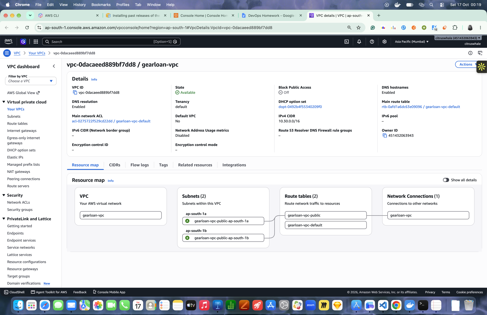 | 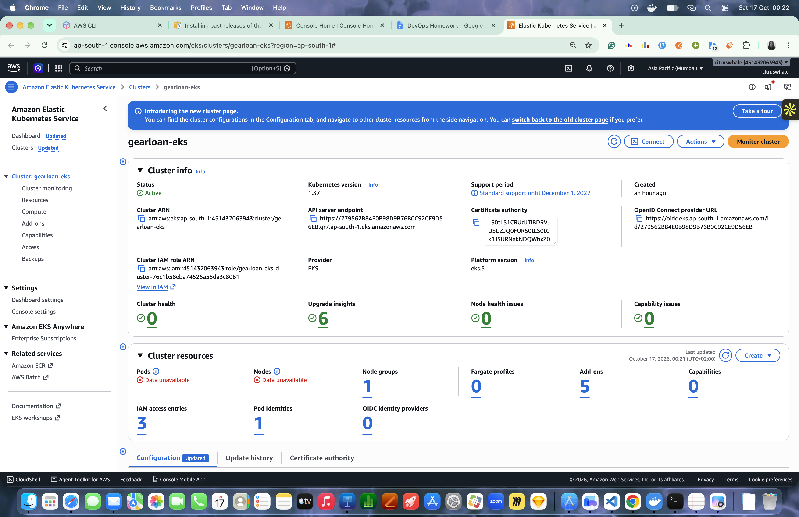 |
| 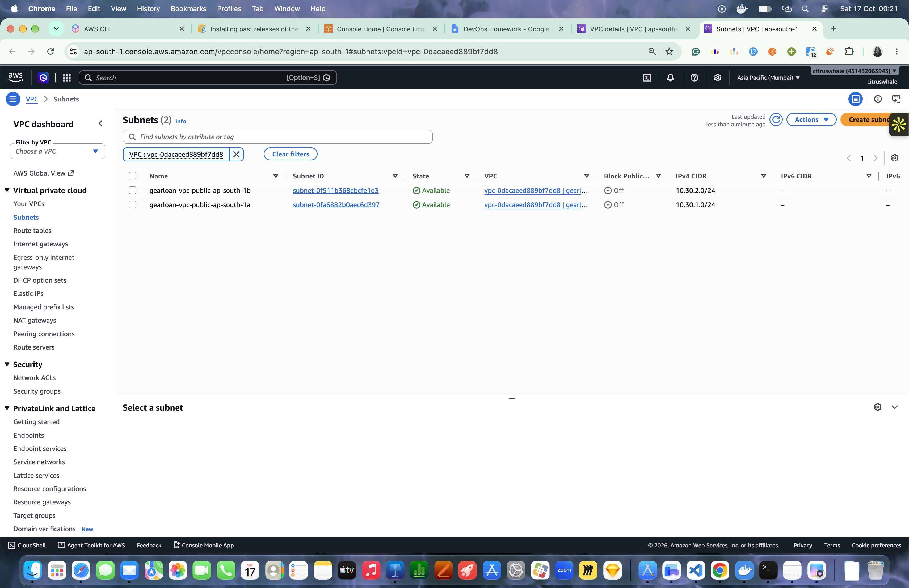 | 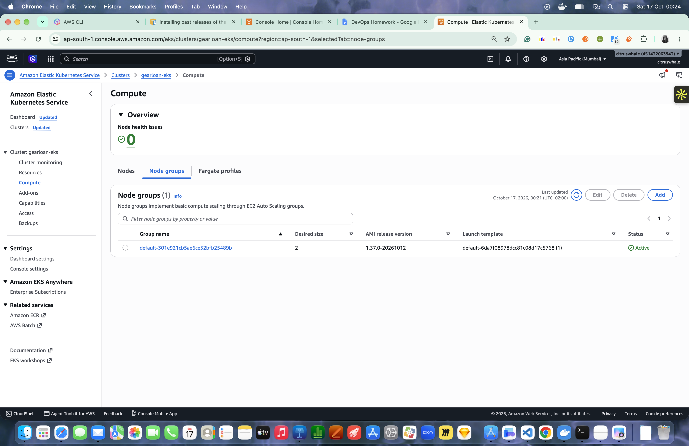 |

> **Two things my AWS account didn't allow** (it's a new account on the AWS Free plan):
> 1. **t3.medium workers.** The first node group never started; CloudTrail showed `RunInstances → "The specified instance type is not eligible for Free Tier"`. I stopped Terraform, switched to **m7i-flex.large** (free-plan eligible, x86, 8 GiB) and applied again. Log of that attempt: [`attempt1-t3medium-not-allowed-on-free-plan.txt`](evidence/terraform/attempt1-t3medium-not-allowed-on-free-plan.txt).
> 2. **Load balancers.** `CreateLoadBalancer → OperationNotPermitted: This AWS account currently does not support creating load balancers` — even after upgrading the account to the Paid plan. AWS Support has to enable it for new accounts. So instead of an NLB, the ingress-nginx Service is a **NodePort (30080)** and the app is reached over the internet on a worker node's public AWS IP. Terraform adds a security group rule that opens 30080 **only to my own IP** (`ingress_allowed_cidrs`), plus a node-to-node TCP 80 rule so traffic arriving on either node reaches the ingress Pod.

---

## 10. Kubernetes + Helm

**Bootstrap** ([`k8s/`](k8s/)): `namespace.yaml` (namespace `gearloan` with Pod Security `restricted`), `bootstrap/storageclass-gp3.yaml` (EBS gp3, `WaitForFirstConsumer`, default), `argocd/application.yaml`.

**Helm chart** ([`helm/gearloan/`](helm/gearloan/)): `Chart.yaml`, `values.yaml` (defaults), `values-local.yaml` (Minikube) and `values-eks.yaml` (EKS + the CI image tags). Templates:

| Template | What it creates |
|---|---|
| `backend-deployment.yaml` | FastAPI, 2+ replicas (HPA), init container that waits for the DB, startup/readiness (`/ready`)/liveness (`/health`) probes, requests/limits, non-root, read-only root FS |
| `frontend-deployment.yaml` | nginx SPA, 2+ replicas (HPA), probes, `/tmp` emptyDir |
| `postgres-statefulset.yaml` | PostgreSQL 17, PVC from `volumeClaimTemplates`, `PGDATA` in a subfolder (avoids `lost+found`) |
| `*-service.yaml` | **ClusterIP** for backend (8000) and frontend (8080); headless for Postgres |
| `ingress.yaml` | **`/` → frontend**, **`/api` → backend** |
| `hpa.yaml` | autoscaling/v2, CPU 70%, 2–5 Pods for each tier |
| `configmap.yaml`, `secret.yaml` | app settings; DB password (generated once and kept on upgrades, or `existingSecret`) |
| `servicemonitor.yaml` | lets Prometheus scrape backend `/metrics` |

**Migrations:** the backend runs `alembic upgrade head` at start while holding a Postgres advisory lock, so with 2 replicas only one runs it and the other waits. It was tested on Minikube with 2 replicas.

**HPA vs GitOps:** when the HPA is on, the chart leaves `replicas:` out of the Deployments, and the Argo CD Application ignores `/spec/replicas`, so the HPA owns the Pod count.

```bash
kubectl apply -f k8s/namespace.yaml
kubectl apply -f k8s/bootstrap/storageclass-gp3.yaml                 # EKS only
kubectl create secret generic gearloan-db -n gearloan --from-literal=postgres-password="$(openssl rand -hex 16)"
helm upgrade --install gearloan helm/gearloan -n gearloan -f helm/gearloan/values-eks.yaml --wait
# or let Argo CD do it:
kubectl apply -f k8s/argocd/application.yaml
```

Local test on Minikube (all Running, data survives Pod restarts, upgrade works): [`evidence/k8s-local/`](evidence/k8s-local/).

**EKS evidence** ([`evidence/eks/`](evidence/eks/)):

The app over the internet, through the Ingress on EKS (`http://<node public IP>:30080`):

| Desktop | Phone |
|---|---|
| 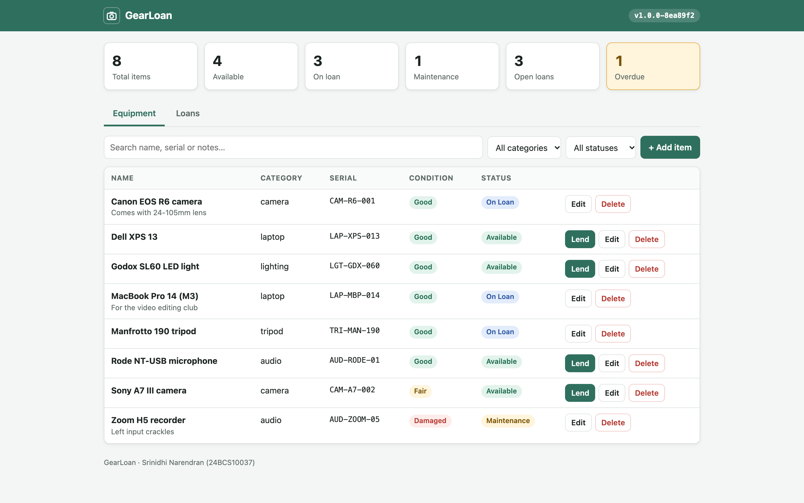 | 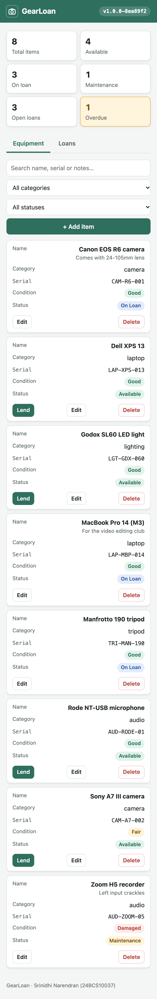 |

```text
$ kubectl get pods -n gearloan                       # all Running, spread over both nodes / AZs
gearloan-backend-55fb999cdb-2bdgl    1/1     Running   10.30.2.179   ip-10-30-2-248
gearloan-backend-55fb999cdb-wjg6f    1/1     Running   10.30.1.13    ip-10-30-1-190
gearloan-frontend-5c7bf69b5-8vptp    1/1     Running   10.30.2.12    ip-10-30-2-248
gearloan-frontend-5c7bf69b5-dmn8n    1/1     Running   10.30.1.173   ip-10-30-1-190
gearloan-postgres-0                  1/1     Running   10.30.2.149   ip-10-30-2-248

$ kubectl get svc,ingress,hpa,pvc -n gearloan
service/gearloan-backend    ClusterIP   172.20.9.100   8000/TCP
service/gearloan-frontend   ClusterIP   172.20.122.9   8080/TCP
service/gearloan-postgres   ClusterIP   None           5432/TCP
ingress/gearloan            nginx   *   80
hpa/gearloan-backend        cpu: 12%/70%   2  5  2
hpa/gearloan-frontend       cpu: 2%/70%    2  5  2
pvc/data-gearloan-postgres-0   Bound   5Gi   RWO   gp3

$ kubectl get application -n argocd
gearloan   Synced   Healthy
```
- Full output: [`kubectl-get-all.txt`](evidence/eks/kubectl-get-all.txt) ([image](evidence/eks/kubectl-get-all.png)), public access check: [`app-public-access-and-kubectl.txt`](evidence/eks/app-public-access-and-kubectl.txt)
- **`helm upgrade --install` on EKS** → `STATUS: deployed`, `REVISION: 1`, and `helm list` shows the release: [`helm-upgrade-install.txt`](evidence/eks/helm-upgrade-install.txt) ([image](evidence/eks/helm-upgrade-install.png)). I ran it in a separate namespace (`gearloan-helm`) and removed it afterwards, because in `gearloan` the same chart is installed by **Argo CD** (Argo CD renders the chart itself, so it doesn't appear in `helm list`).
- **Argo CD:** `gearloan` Synced and Healthy on EKS:

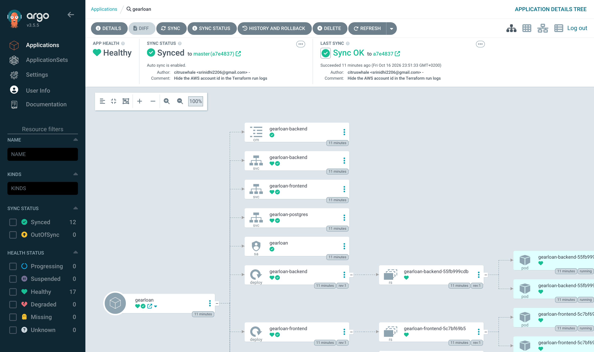

- **GitOps flow on EKS**, really happening: each push to master → green pipeline → bot commit with the new tag → Argo CD sync → new pods. Argo CD history and the matching commits: [`gitops-history.txt`](evidence/eks/gitops-history.txt) (e.g. `cea8e2a` → bot `09863ed` → app reported `1.0.0-cea8e2a`).

## 11. Observability – Prometheus + Grafana ([`monitoring/`](monitoring/))

- **`/metrics`** on the backend ([sample output](evidence/local/metrics-output.txt)):
  - `http_requests_total{method,path,status}`: path is the route template (`/api/items/{item_id}`), so labels don't explode
  - `http_request_duration_seconds` histogram
  - `gearloan_loans_created_total`, `gearloan_loans_returned_total`, `gearloan_items_created_total`
- **Prometheus:** kube-prometheus-stack 92.10.1 ([values](monitoring/kube-prometheus-stack-values.yaml)). The chart's ServiceMonitor makes the job `gearloan-backend`.
- **Grafana:** my own dashboard ([JSON](monitoring/dashboards/gearloan-overview.json)) with 10 panels: requests/s, error rate, p95, Pods up, requests by route, by status, p50/p95/p99, loans per minute, CPU, memory.
- **Alerts:** [`gearloan-alerts.yaml`](monitoring/gearloan-alerts.yaml) has backend down, >20% 4xx, and p95 > 500 ms.

Tested on Minikube: targets **UP**, live dashboard, and the 4xx alert **fired and then resolved**. Full write-up in [Session 20](../Sesh%2020%20Monitoring%20GitOps/README.md).


**EKS monitoring evidence** (normal traffic from the traffic generator):

```text
$ curl -s http://<node ip>:30080/api/metrics | grep http_requests_total      # through the Ingress
http_requests_total{method="GET",path="/health",status="200"} 40.0
http_requests_total{method="GET",path="/api/stats",status="200"} 67.0
...
```
Full sample: [`metrics-through-ingress.txt`](evidence/eks/metrics-through-ingress.txt)

| Prometheus target UP (2/2) | Grafana, live on EKS |
|---|---|
| 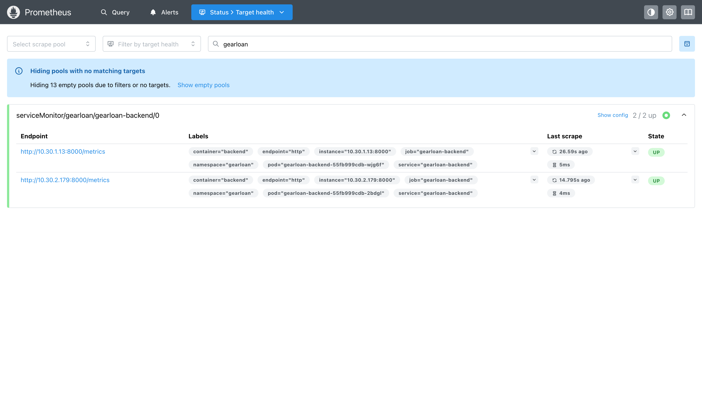 | 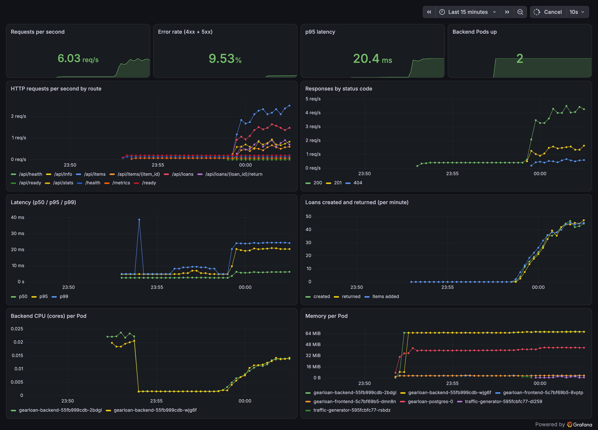 |

## 12. Troubleshooting notes (real problems I hit)

| Problem | Cause | Fix |
|---|---|---|
| Grafana Pod kept restarting | `OOMKilled`: Grafana 13 needs ~650–700 MiB | memory limit raised to 1 GiB in the values file |
| HPA showed `<unknown>` for ~1 minute | metrics-server has no numbers yet for new Pods | wait; the HPA also needs CPU **requests** to be set |
| Images built on my Mac are arm64 | EKS nodes are x86 | CI builds `linux/amd64`, and EKS only uses CI images |
| Gitleaks flagged the image tag `s16-gear-api:<sha>` | the generic-api-key rule matches a 40-character commit SHA | 3 exact findings added to `.gitleaksignore` with a comment. It's not a secret |
| Two backend Pods starting at once could both run migrations | race on first install | Postgres advisory lock around `alembic upgrade` |

## 13. Cleanup
```bash
# local
docker compose down -v
# EKS: stop Argo CD first (or it re-creates things), delete the PVCs (EBS volumes) and any LoadBalancer Service, then the cluster
kubectl delete -n argocd application gearloan
helm uninstall ingress-nginx -n ingress-nginx       # would remove the NLB if one existed
kubectl delete pvc --all -n gearloan                # removes the EBS volumes
cd terraform && terraform destroy
```

## 14. Known limitations
- Minikube and EKS are both single-region labs. There's no NAT gateway, no private subnets and no multi-AZ database, to keep the cost low.
- PostgreSQL runs as one Pod with one EBS volume (not RDS, no replica, no backups).
- No login or users: anyone who can open the app can lend items.
- **No AWS load balancer:** my account can't create one yet (see section 9), so the app is reached on a node's public IP, port 30080, opened only to my IP. With ELB enabled, `INGRESS_SERVICE_TYPE=LoadBalancer ./scripts/eks-bootstrap.sh` gives an NLB instead.
- Plain HTTP, no TLS certificate.
- No traces yet (OpenTelemetry would be the next step).
- The EKS cluster is destroyed after the demo, so there's **no permanent live URL**. The recordings and screenshots in [`evidence/`](evidence/) and [`demo/`](demo/) show it working, and everything can be recreated with the commands above.

## 15. Evidence index
| Rubric item | Evidence |
|---|---|
| M1 app in the browser | [desktop](evidence/screenshots/app-desktop-items.png) · [phone](evidence/screenshots/app-mobile-items.png) · [browser test screenshots + log](evidence/browser-test/) |
| M2 `pytest -v` passing | [image](evidence/screenshots/pytest-28-passed.png) · [text](evidence/local/pytest-output.txt) |
| M3 commit history (≥10 commits) | [GitHub commit history](evidence/screenshots/github-commit-history.png) |
| M4 `docker compose up --build`, non-root | [image](evidence/screenshots/docker-compose-up-build.png) · [text](evidence/local/compose-up.txt) |
| M4 app at `localhost:3000` | [desktop](evidence/screenshots/app-desktop-items.png) |
| M5 green pipeline | [run 38964516947](https://github.com/citruswhale/Shell_Scripting_Basics/actions/runs/38964516947) · [screenshot](evidence/screenshots/github-actions-capstone-green.png) · [log excerpt](evidence/ci/github-actions-run-38964516947.txt) |
| M5 GHCR images with SHA tags | [backend](evidence/screenshots/ghcr-gearloan-backend.png) · [frontend](evidence/screenshots/ghcr-gearloan-frontend.png) · [versions](evidence/screenshots/ghcr-gearloan-backend-versions.png) |
| M6 Trivy output + explanation | [log excerpt (both images)](evidence/ci/github-actions-run-38964516947.txt) · [section 8](#8-devsecops--trivy-and-other-gates) |
| M7 `terraform plan` | [image](evidence/terraform/terraform-plan.png) · [full run log](evidence/terraform/terraform-eks-run.txt) |
| M7 AWS Console: VPC + EKS | [VPC](evidence/aws-console/vpc.png) · [subnets](evidence/aws-console/subnets.png) · [EKS cluster](evidence/aws-console/eks-cluster.png) · [node group](evidence/aws-console/eks-compute.png) |
| M7 `terraform destroy` | [image](evidence/terraform/terraform-destroy.png) · [full log + leftover check](evidence/terraform/terraform-destroy.txt) |
| M8 `kubectl get pods` / `svc`, all Running | [image](evidence/eks/kubectl-pods-svc-ingress.png) · [full text](evidence/eks/kubectl-get-all.txt) |
| M8 `helm upgrade --install` + `helm list` | [image](evidence/eks/helm-upgrade-install.png) · [text](evidence/eks/helm-upgrade-install.txt) |
| M8 app through the Ingress | [desktop](evidence/eks/app-through-ingress.png) · [phone](evidence/eks/app-through-ingress-mobile.png) |
| M9 `/metrics` | [compose](evidence/screenshots/backend-metrics-curl.png) · [EKS via Ingress](evidence/eks/metrics-through-ingress.txt) |
| M9 Prometheus target UP | [EKS](evidence/eks/prometheus-targets-up.png) |
| M9 Grafana with live panels | [EKS](evidence/eks/grafana-gearloan-dashboard.png) |
| GitOps (Argo CD) | [synced on EKS](evidence/eks/argocd-gearloan-synced.png) · [sync history](evidence/eks/gitops-history.txt) |
| M10 slides + video | [`demo/GearLoan-presentation.pptx`](demo/GearLoan-presentation.pptx) · [PDF](demo/GearLoan-presentation.pdf) · [`demo/GearLoan-demo.mp4`](demo/GearLoan-demo.mp4) |

All AWS resources were destroyed after the demo (`Destroy complete! Resources: 47 destroyed.`, state empty, and a check found no EKS, EC2, EBS, load balancer, NAT, Elastic IP, VPC, IAM role or S3 bucket left), so there is no live URL any more. The commands in sections 5, 9 and 10 recreate everything.
