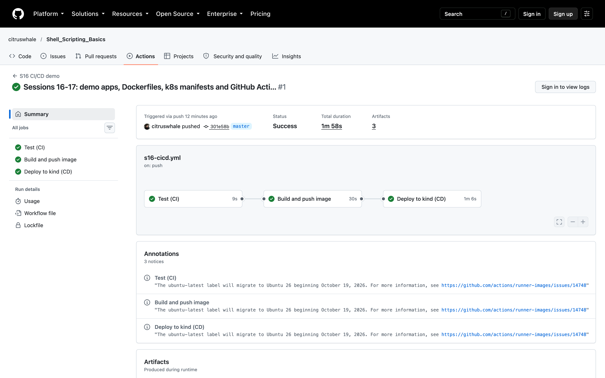
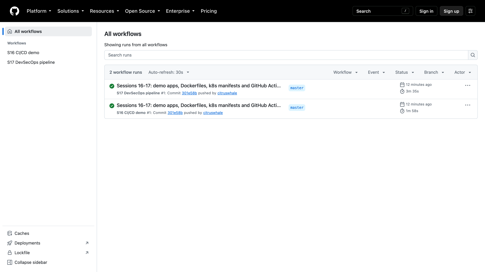

# Session 16 – CI/CD & GitHub Actions

**Name:** Srinidhi Narendran · **Roll No:** 24BCS10037 · **Batch:** B

I built a small demo project with a full **CI/CD pipeline in GitHub Actions**. Every push that changes this folder runs the tests, builds a Docker image, pushes it to GitHub Container Registry (GHCR), and then deploys it to a real Kubernetes cluster (kind) inside the runner, where a smoke test checks it.

- **Workflow file:** [`.github/workflows/s16-cicd.yml`](../../.github/workflows/s16-cicd.yml)
- **Green run:** https://github.com/citruswhale/Shell_Scripting_Basics/actions/runs/38961008859 (commit `301e58b`, 1m58s, all 3 jobs passed)
- **Concept notes** (CI vs CD, workflow, jobs, steps, runners, secrets, artifacts, triggers): [`CONCEPTS.md`](CONCEPTS.md)
- **Log excerpt from that run:** [`outputs/github-actions-run-38961008859.txt`](outputs/github-actions-run-38961008859.txt)



## The application

[`app/`](app/) is **Gear API**, a tiny Node.js (Express) service from my GearLoan idea.

| Route | Returns |
|---|---|
| `GET /` | `{"app","version","commit"}`. The commit SHA is passed in at deploy time, so I can prove which build is running |
| `GET /health` | `{"status":"ok"}` (used by the probes) |
| `GET /api/gear` | a small list of equipment; `?available=true` filters it |
| anything else | a 404 JSON error |

- 6 unit tests with Node's built-in test runner, in [`app/test/app.test.js`](app/test/app.test.js).
- [`app/Dockerfile`](app/Dockerfile) is a multi-stage build on `node:24-alpine`: `npm ci --omit=dev`, runs as the non-root `node` user, and has a `HEALTHCHECK`.
- [`k8s/`](k8s/) holds a Namespace `s16`, a Deployment (2 replicas, probes, resources) and a Service, used by the CD job.

Run it locally:
```bash
cd app && npm ci && npm test && npm start        # http://localhost:3000
docker build -t s16-gear-api app && docker run -p 3000:3000 s16-gear-api
```

## The pipeline

```text
 git push (changes in submissions/16-cicd/**)
        │
        ▼
 ┌──────────────┐     ┌─────────────────────────┐     ┌──────────────────────────────┐
 │  Test (CI)   │ ──► │  Build and push image   │ ──► │      Deploy to kind (CD)     │
 │ npm ci       │     │ docker buildx           │     │ create kind cluster          │
 │ npm test     │     │ push to GHCR :<sha>     │     │ load image, kubectl apply    │
 │ upload report│     │ upload build-info       │     │ rollout status + smoke test  │
 └──────────────┘     └─────────────────────────┘     └──────────────────────────────┘
      needs: –              needs: test                       needs: build
```

| Concept | Where it is in my workflow |
|---|---|
| **Workflow** | `s16-cicd.yml`, named "S16 CI/CD demo" |
| **Trigger** | `on: push` to `master` with a `paths:` filter (only this folder and the workflow file), plus `workflow_dispatch` so I can run it by hand |
| **Jobs** | `test`, `build`, `deploy`, chained with `needs:` so each one only starts if the one before passed |
| **Steps** | e.g. *Check out code → Set up Node.js 24 → Install dependencies → Run unit tests → Upload test report* |
| **Runner** | `ubuntu-latest`, a fresh GitHub-hosted VM for every job |
| **Secrets** | `secrets.GITHUB_TOKEN` logs in to GHCR (no password stored anywhere). `permissions:` limits it to `contents: read` + `packages: write`. There's also an optional `DEMO_SECRET` step that shows how a custom secret would be used and doesn't fail if it's missing |
| **Artifacts** | `s16-test-report` (spec + JUnit test results) and `s16-build-info` (image name, digest, commit) |
| **Build** | `docker/build-push-action`, image tagged with the **commit SHA** |
| **Test** | `npm test` (a failing test stops the whole pipeline, so nothing broken is built or deployed) |
| **CI** | the `test` + `build` jobs: every change is tested and packaged automatically |
| **CD** | the `deploy` job: the exact image that was built is deployed to Kubernetes and checked, with no manual steps |

## What the run did (real output)

**Test (CI)**, 6 out of 6 passed:
```text
✔ GET / returns app name, version and commit (36.176084ms)
✔ GET /health returns ok (4.394401ms)
✔ GET /api/gear returns the full list (2.645039ms)
✔ GET /api/gear?available=true returns only available items (4.013704ms)
✔ unknown route returns 404 JSON (2.451994ms)
✔ listGear items have id, name, category and available (0.554969ms)
ℹ tests 6
ℹ pass 6
ℹ fail 0
```

**Build and push image**, from the `s16-build-info` artifact:
```text
image:   ghcr.io/citruswhale/s16-gear-api:301e58bfb387a8042060d2736d061328dae355fd
digest:  sha256:0d2f0d2767ad9259cf56f6bdaec577a3b3f9b01ebc3e2c807b2a7f691c59e6fc
commit:  301e58bfb387a8042060d2736d061328dae355fd
```

**Deploy to kind (CD)**: the smoke test checks that the running app reports the same commit that triggered the pipeline:
```text
GET / -> {"app":"s16-gear-api","version":"1.0.0","commit":"301e58bfb387a8042060d2736d061328dae355fd"}
{"status":"ok"}
```

| Job | Started → finished (UTC) | Result |
|---|---|---|
| Test (CI) | 20:16:14 → 20:16:23 | success |
| Build and push image | 20:16:27 → 20:16:57 | success |
| Deploy to kind (CD) | 20:17:01 → 20:18:07 | success |



## Notes
- The image tag is the Git commit SHA, never only `latest`, so every running copy can be traced back to the exact code.
- New GHCR packages are **private** by default. The deploy job logs in and pulls the image itself, so it works without making the package public.
- The kind cluster exists only during the job. It proves the manifests and image really work in Kubernetes, but it is not a long-running environment. My capstone deploys to a real cluster.
