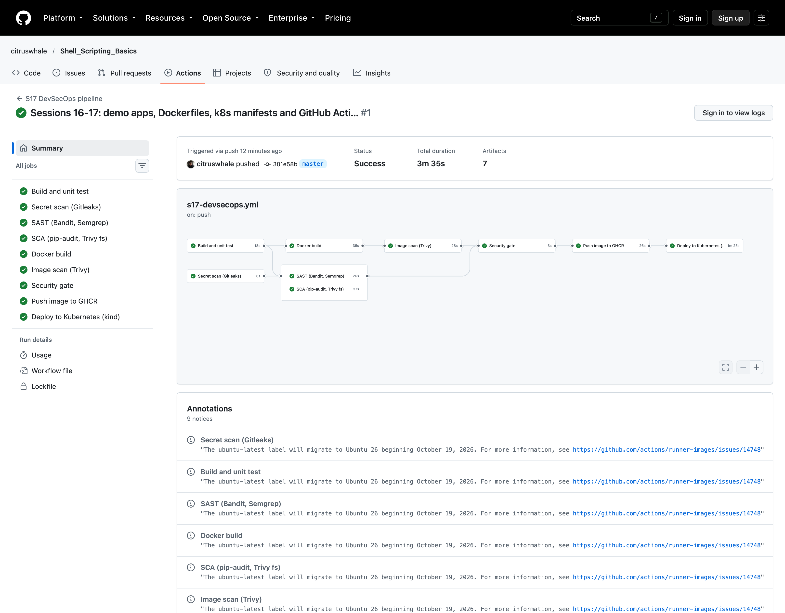

# Session 17 – Complete CI/CD & DevSecOps

**Name:** Srinidhi Narendran · **Roll No:** 24BCS10037 · **Batch:** B

A CI/CD pipeline with **security checks built in**. The image is only pushed to the registry and deployed if the tests, code scans, dependency scans, secret scan and container scan all pass.

- **Workflow:** [`.github/workflows/s17-devsecops.yml`](../../.github/workflows/s17-devsecops.yml)
- **Green run:** https://github.com/citruswhale/Shell_Scripting_Basics/actions/runs/38961008905 (commit `301e58b`, 3m35s, 9 jobs, 7 artifacts)
- **Log excerpt from that run:** [`outputs/github-actions-run-38961008905.txt`](outputs/github-actions-run-38961008905.txt)



## The application

[`app/`](app/) is **Loan Calculator**, a small FastAPI service that works out the late fee for overdue GearLoan equipment.

| Route | What it does |
|---|---|
| `GET /health` | `{"status":"ok"}` |
| `GET /version` | app name, version and the commit SHA it was built from |
| `GET /fee?days_late=5&daily_rate=20` | fee after a 1-day grace period, capped at 500. Returns `80.0` for this example; bad input gives `422` |

- 12 pytest tests in [`app/tests/test_api.py`](app/tests/test_api.py).
- Dependencies are pinned in `requirements.txt`, compiled from `requirements.in`.
- [`app/Dockerfile`](app/Dockerfile) is a multi-stage `python:3.12-slim` build that runs as non-root user `10001` with a `HEALTHCHECK`.
- [`k8s/`](k8s/) has a Namespace (Pod Security `restricted`), a Deployment (2 replicas, probes, resources, read-only root filesystem, all capabilities dropped, seccomp) and a Service.

## Pipeline flow

This is the expected flow from the homework, and how my jobs map onto it:

```text
Code ─► Build + Unit Test ─► SAST ─► SCA ─► Secret Scan ─► Docker Build ─► Image Scan ─► Security Gate ─► Push Image ─► Deploy to K8s
         build-test          sast    sca    secret-scan    docker-build    image-scan    security-gate    push          deploy
```

On GitHub the independent checks run **in parallel** to save time. The **security gate** waits for all of them (`needs:` on every check job), so nothing is pushed unless every check passed:

```text
 build-test ─┬─► docker-build ─► image-scan ─┐
             ├─► sast ───────────────────────┤
             └─► sca ────────────────────────┼─► security-gate ─► push ─► deploy
 secret-scan ────────────────────────────────┘
```

| Stage | Tool | Gate (fails the run when...) | Result in run 38961008905 |
|---|---|---|---|
| Build + unit test | pytest | any test fails | `12 passed` |
| **SAST** (my own code) | Bandit | any issue found | `No issues identified.` (42 lines, 0 Low/Medium/High) |
| **SAST** | Semgrep `p/python` | any finding (`--error`) | `Ran 151 rules on 3 files: 0 findings.` |
| **SCA** (dependencies) | pip-audit `--strict` | any known vulnerability | `No known vulnerabilities found` |
| **SCA** | Trivy fs | HIGH/CRITICAL in `requirements.txt` | `Clean (no security findings detected)` |
| **Secret scan** | Gitleaks 8.30.1 over the **whole Git history** | any leak | `30 commits scanned. no leaks found` |
| Docker build | buildx | build error | image saved as an artifact (`s17-image`) |
| **Image scan** | Trivy 0.76.0 | HIGH/CRITICAL with a fix available | Debian 13.7: **0**, every Python package: **0** |
| **Security gate** | `needs:` all of the above | any check failed | `Security gate: PASSED` |
| Push | GHCR via `GITHUB_TOKEN` | – | `ghcr.io/citruswhale/s17-loan-calculator:301e58b…` |
| Deploy | kind + kubectl | rollout or smoke test fails | 2/2 Pods Running; `/health` ok, `/fee` = 80.0, bad input = 422 |

**The image that gets pushed is the same one that was scanned.** It's built once and saved as a tarball. Then it's scanned, and the push job loads that same tarball. It's never rebuilt in between.

### Security tool settings ([`security/`](security/))
- [`trivy.yaml`](security/trivy.yaml): `severity: [HIGH, CRITICAL]`, `exit-code: 1`, `ignore-unfixed: true`.
- [`bandit.yaml`](security/bandit.yaml): scans `app/`, skips the tests folder (asserts in tests are normal).
- Gitleaks uses its default rules. The repo's [`.gitleaksignore`](../../.gitleaksignore) only lists the 4 made-up Session 12 lab passwords.

**About `ignore-unfixed`:** without it, Trivy reports some HIGH CVEs in Debian 13 base packages that have **no fixed version released yet**, so there is nothing I can upgrade to. Failing on those would block every build without making anything safer. The gate still fails on any HIGH or CRITICAL that **does** have a fix. I didn't add any `.trivyignore` suppressions.

## Real output from the run

```text
# Image scan (Trivy) - Report Summary
│ /home/runner/work/_temp/image.tar (debian 13.7)                                  │   debian   │        0        │
│ opt/venv/lib/python3.12/site-packages/fastapi-0.143.3.dist-info/METADATA         │ python-pkg │        0        │
│ opt/venv/lib/python3.12/site-packages/starlette-1.8.0.dist-info/METADATA         │ python-pkg │        0        │
│ opt/venv/lib/python3.12/site-packages/pydantic-2.14.1.dist-info/METADATA         │ python-pkg │        0        │
...

# Push image to GHCR
The push refers to repository [ghcr.io/citruswhale/s17-loan-calculator]
dca2a125b490: Pushed
...

# Deploy to Kubernetes (kind) - smoke test
{"status":"ok"}
GET /version -> {"app":"s17-loan-calculator","version":"1.0.0","commit":"301e58bfb387a8042060d2736d061328dae355fd"}
GET /fee?days_late=5&daily_rate=20 -> {"days_late":5,"daily_rate":20.0,"grace_days":1,"max_fee":500.0,"fee":80.0,"capped":false}
GET /fee with days_late=-1 -> HTTP 422

deployment.apps/loan-calculator   2/2   ...   ghcr.io/citruswhale/s17-loan-calculator:301e58bfb387a8042060d2736d061328dae355fd
pod/loan-calculator-66bd8ff954-jhj25   1/1     Running   0          11s
pod/loan-calculator-66bd8ff954-wnq4n   1/1     Running   0          19s
```

**What the scan result means:** Trivy checked the OS packages of the final image (Debian 13.7) and every Python package installed in it, against its vulnerability database on the day of the run. It found no HIGH or CRITICAL problem that has a fix. A clean scan doesn't mean the app is perfectly secure, though: it only knows about **published** CVEs, it doesn't test my logic or configuration, and new CVEs appear every day. That's why the scan runs on every push.

### Artifacts saved by the run
`s17-unit-tests` (JUnit), `s17-sast-reports` (Bandit + Semgrep JSON/SARIF), `s17-sca-reports`, `s17-gitleaks-report`, `s17-image` (the tarball), `s17-image-scan-reports` (Trivy JSON + SARIF). The Trivy SARIF is also uploaded to GitHub code scanning.

## Least-privilege permissions
The workflow defaults to `contents: read`. Only the jobs that need more get it:
- `image-scan`: `security-events: write` (SARIF upload)
- `push`: `packages: write`
- `deploy`: `packages: read`

There are no long-lived passwords; GHCR uses the short-lived `GITHUB_TOKEN`.

## Run it locally
```bash
cd app
python3.12 -m venv .venv && . .venv/bin/activate
pip install -r requirements-dev.txt
pytest -v
bandit -c ../security/bandit.yaml -r app
pip-audit -r requirements.txt --strict
trivy fs --config ../security/trivy.yaml .
docker build -t s17-loan-calculator .
trivy image --config ../security/trivy.yaml s17-loan-calculator
```
