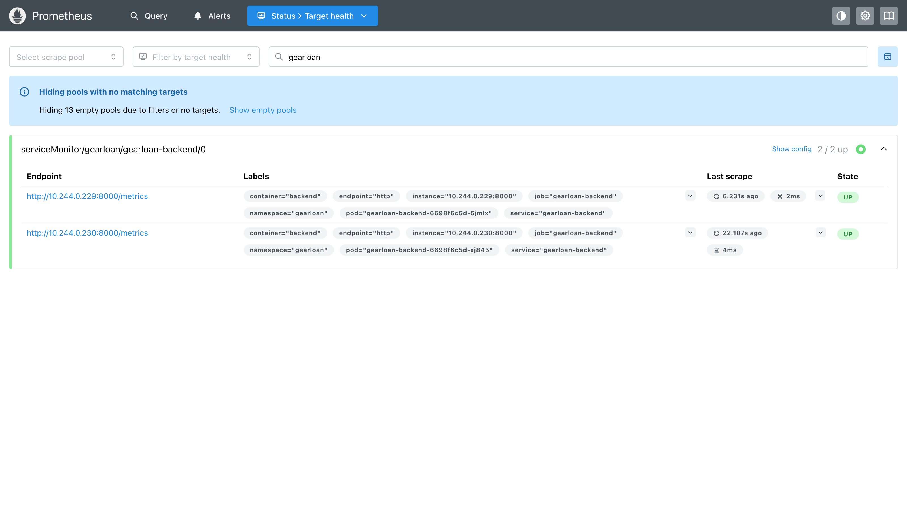
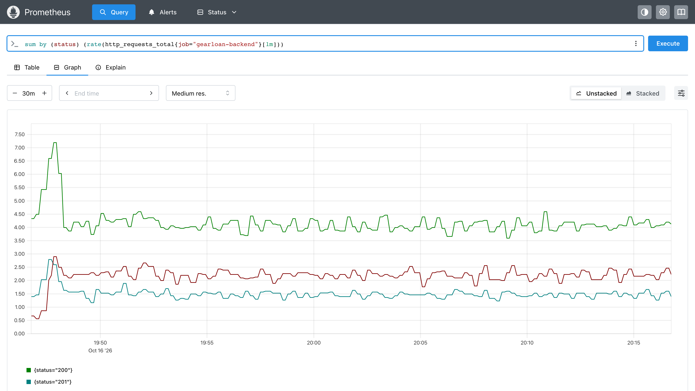
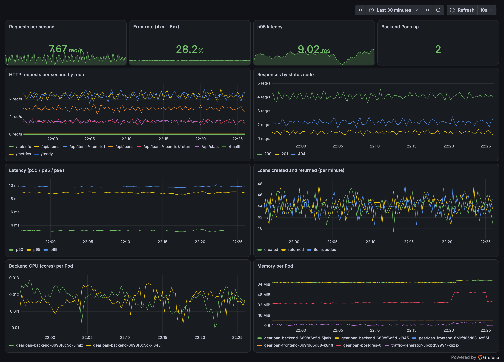
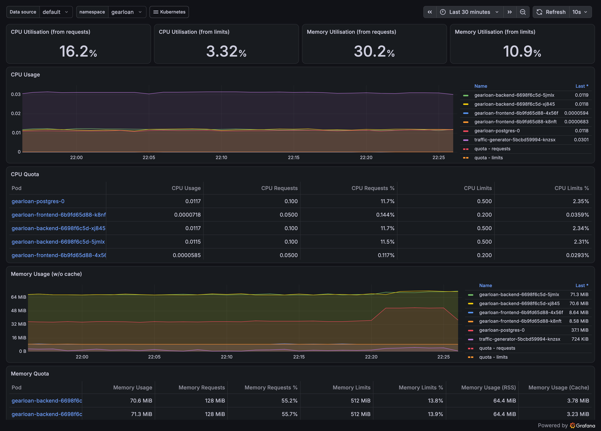
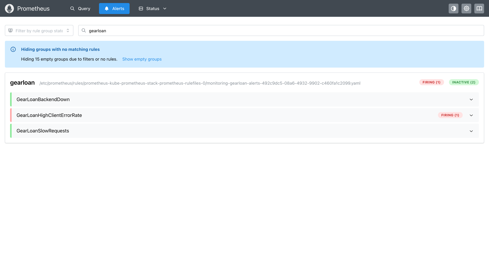
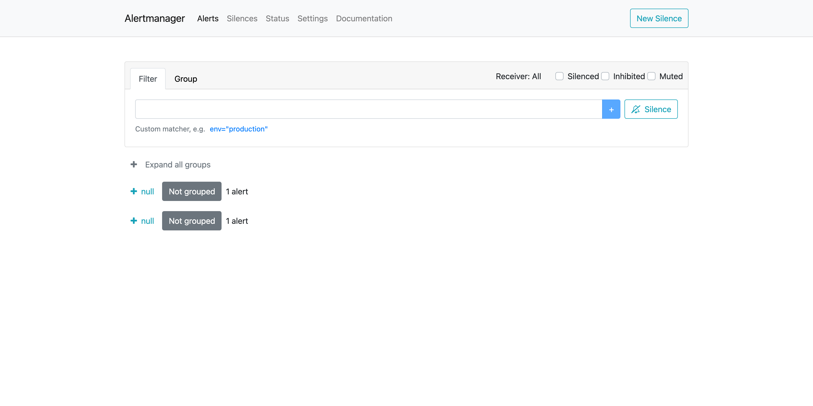
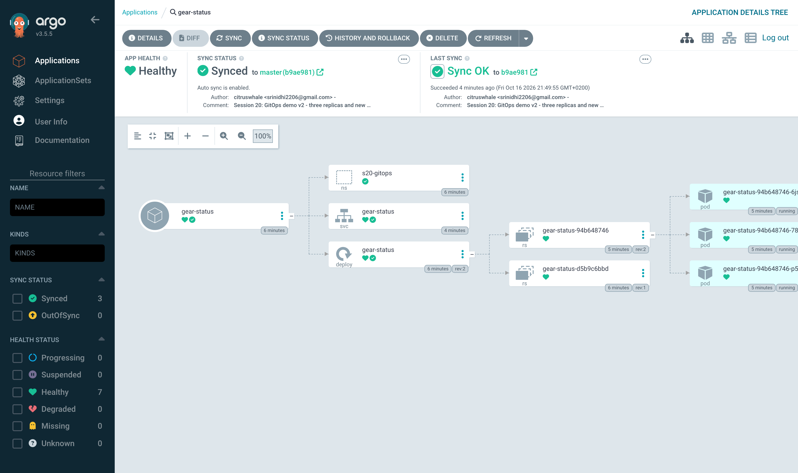

# Session 20 – Monitoring, Observability & GitOps

**Name:** Srinidhi Narendran · **Roll No:** 24BCS10037 · **Batch:** B

What I set up on my Minikube cluster (`devops-lab`, Kubernetes v1.37):
- **Monitoring:** Prometheus + Grafana + Alertmanager (kube-prometheus-stack) watching my capstone app **GearLoan**. I built my own dashboard and alert rules, sent real traffic, and made an alert fire and then resolve.
- **GitOps:** Argo CD keeping a small app in sync with **my GitHub repo**. I changed Git → Argo CD deployed it; I changed the cluster by hand → Argo CD put it back.

Theory notes (metrics/logs/alerts, the 3 pillars, GitOps ideas): **[`CONCEPTS.md`](CONCEPTS.md)**
Raw output: [`outputs/`](outputs/) · Screenshots: [`screenshots/`](screenshots/)

---

## Task 1 – Monitoring demo

### Setup
| Part | What I used |
|---|---|
| App being watched | GearLoan (FastAPI backend ×2, frontend ×2, PostgreSQL), Helm release `gearloan` in namespace `gearloan` |
| App metrics | backend `/metrics`: `http_requests_total{method,path,status}`, `http_request_duration_seconds` histogram, `gearloan_loans_created_total`, `gearloan_loans_returned_total`, `gearloan_items_created_total` |
| Monitoring stack | `prometheus-community/kube-prometheus-stack` **92.10.1**, values in [`session21-python/monitoring/kube-prometheus-stack-values.yaml`](../../session21-python/monitoring/kube-prometheus-stack-values.yaml) |
| Scraping | a **ServiceMonitor** from my Helm chart (`serviceMonitor.enabled=true`) → job `gearloan-backend`, every 30 s |
| Dashboard | [`gearloan-overview.json`](../../session21-python/monitoring/dashboards/gearloan-overview.json), loaded by the Grafana sidecar from a ConfigMap labelled `grafana_dashboard=1` |
| Alerts | [`gearloan-alerts.yaml`](../../session21-python/monitoring/gearloan-alerts.yaml) (PrometheusRule): backend down, >20% 4xx, p95 > 500 ms |
| Traffic | [`traffic-generator.yaml`](../../session21-python/monitoring/traffic-generator.yaml): adds an item, searches, lends, returns, reads stats, and sometimes asks for items that don't exist (404) |

```bash
helm upgrade --install kube-prometheus-stack prometheus-community/kube-prometheus-stack --version 92.10.1 \
  -n monitoring --create-namespace -f session21-python/monitoring/kube-prometheus-stack-values.yaml \
  --set grafana.adminPassword="$GRAFANA_PASSWORD"          # password kept out of git
helm upgrade gearloan session21-python/helm/gearloan -n gearloan --reuse-values --set serviceMonitor.enabled=true
kubectl apply -f session21-python/monitoring/gearloan-alerts.yaml
session21-python/monitoring/dashboard-configmap.sh
kubectl apply -f session21-python/monitoring/traffic-generator.yaml
```

```text
$ kubectl get pods -n monitoring
alertmanager-kube-prometheus-stack-alertmanager-0           2/2     Running   0          43m
kube-prometheus-stack-grafana-67bdc759d6-7txtn              3/3     Running   0          101s
kube-prometheus-stack-kube-state-metrics-5cb6764748-jfgth   1/1     Running   0          44m
kube-prometheus-stack-operator-54dff5569f-ntmxn             1/1     Running   0          44m
kube-prometheus-stack-prometheus-node-exporter-dplc6        1/1     Running   0          44m
prometheus-kube-prometheus-stack-prometheus-0               2/2     Running   0          43m
```
Problem I hit: Grafana kept restarting at first. `kubectl describe pod` showed `Reason: OOMKilled`, because Grafana 13 uses about 650–700 MiB. I raised its memory limit to 1 GiB in the values file, and it has been stable since.

### Metrics – Prometheus is scraping the app
Both backend Pods are **UP** under `serviceMonitor/gearloan/gearloan-backend/0`:



```text
gearloan-backend-6698f6c5d-5jmlx  health=up  http://10.244.0.229:8000/metrics
gearloan-backend-6698f6c5d-xj845  health=up  http://10.244.0.230:8000/metrics
```
Real PromQL results while the traffic generator was running:

| Question | PromQL | Answer |
|---|---|---|
| Requests/s by status | `sum by (status) (rate(http_requests_total{job="gearloan-backend"}[2m]))` | 200: 4.17 · 201: 1.44 · 404: 2.22 |
| p95 latency | `histogram_quantile(0.95, sum by (le) (rate(http_request_duration_seconds_bucket{job="gearloan-backend"}[5m])))` | 0.009 s (9 ms) |
| Loans in the last 10 min | `sum(increase(gearloan_loans_created_total{job="gearloan-backend"}[10m]))` | 440 |



### CPU and memory utilisation
```text
$ kubectl top pods -n gearloan
NAME                                 CPU(cores)   MEMORY(bytes)
gearloan-backend-6698f6c5d-5jmlx     12m          71Mi
gearloan-backend-6698f6c5d-xj845     12m          70Mi
gearloan-frontend-6b9fd65d88-4x56f   1m           8Mi
gearloan-frontend-6b9fd65d88-k8nft   1m           8Mi
gearloan-postgres-0                  12m          37Mi
traffic-generator-5bcbd59994-knzsx   33m          2Mi
```
The same numbers come from Prometheus with `rate(container_cpu_usage_seconds_total{namespace="gearloan"}[2m])` and `container_memory_working_set_bytes`, and they appear in the Grafana panels.

### Grafana – my GearLoan dashboard (live data)
It has 10 panels: requests/s, error rate, p95 latency, backend Pods up, requests by route, responses by status code, p50/p95/p99 latency, loans created/returned per minute, CPU per Pod, and memory per Pod.



The built-in "Kubernetes / Compute Resources / Namespace (Pods)" dashboard for `gearloan`:



### Application health
- `GET /health` → `{"status":"ok"}` (liveness, doesn't touch the DB). `GET /ready` → `{"status":"ready"}` (readiness, runs `SELECT 1` on PostgreSQL).
- Kubernetes uses them as probes, and `kube_pod_status_ready{namespace="gearloan",condition="true"}` was `1` for every Pod.
- Prometheus's own `up{job="gearloan-backend"}` is `1` for both Pods, and the `GearLoanBackendDown` alert fires if it drops to 0 for a minute.

### Logs
```text
$ kubectl logs -n gearloan deploy/gearloan-backend --tail=6
Defaulted container "backend" out of: backend, wait-for-db (init)
INFO  [alembic.runtime.migration] Will assume transactional DDL.
Starting GearLoan API (version 1.0.1)...
INFO:     Started server process [1]
INFO:     Application startup complete.
INFO:     Uvicorn running on http://0.0.0.0:8000 (Press CTRL+C to quit)
```
In this lab, logs are read with `kubectl logs`. A real setup would ship them to Loki or Elasticsearch so they can be searched next to the metrics (see `CONCEPTS.md`).

### Alerts – firing and resolving for real
To test the `GearLoanHighClientErrorRate` rule (more than 20% of requests are 4xx for 1 minute), I made the traffic generator ask for missing items on every loop (`NOT_FOUND_EVERY=1`). The error rate went to about **28%**:
```text
GearLoanHighClientErrorRate  state=firing  since=2026-10-16T19:48:32Z
```



Then I set it back to normal (`NOT_FOUND_EVERY=4`). A few minutes later the 4xx share was **8.9%** and the alert had cleared by itself:
```text
22:30:31
0.08880994671403196
no GearLoan alerts active (GearLoanHighClientErrorRate resolved)
```

Full log: [`outputs/01-monitoring.txt`](outputs/01-monitoring.txt)

---

## Task 2 – Observability

The three pillars, why observability is needed, the common tools and Kubernetes observability are explained in **[`CONCEPTS.md`](CONCEPTS.md)**. In this demo:

| Pillar | Where I used it |
|---|---|
| **Metrics** | Prometheus scraping `/metrics`, Grafana dashboards, PromQL queries, alert rules |
| **Logs** | `kubectl logs` for the backend (startup, migrations, Uvicorn) |
| **Traces** | Not set up in this lab. It would need OpenTelemetry in the FastAPI app plus Tempo or Jaeger |

---

## Task 3 – GitOps with Argo CD

### Setup
- Argo CD **v3.5.5**, installed with the official manifests into namespace `argocd`:
  ```bash
  kubectl apply -n argocd --server-side -f https://raw.githubusercontent.com/argoproj/argo-cd/v3.5.5/manifests/install.yaml
  ```
- What Argo CD watches is [`gitops/app/`](gitops/app/): a Namespace `s20-gitops`, a Deployment `gear-status` (2 replicas) and a Service.
- [`gitops/argocd-application.yaml`](gitops/argocd-application.yaml) points Argo CD at `https://github.com/citruswhale/Shell_Scripting_Basics.git`, branch `master`, path `submissions/20-monitoring-gitops/gitops/app`. It has `automated: { prune: true, selfHeal: true }`. The Application file sits **outside** `app/` so Argo CD doesn't try to deploy itself.

### 1. First sync from Git
```text
$ kubectl apply -f gitops/argocd-application.yaml
application.argoproj.io/gear-status created

NAME          SYNC STATUS   HEALTH STATUS
gear-status   Synced        Healthy
repo: https://github.com/citruswhale/Shell_Scripting_Basics.git
path: submissions/20-monitoring-gitops/gitops/app
revision: 83c8c5a2ee434b222013a5151f9dbe66271f2731

deployment.apps/gear-status   2/2     2            2           3s
GearLoan status page - version 1 (deployed by Argo CD)
```
I never ran `kubectl apply` on the app itself; Argo CD created it from Git.

### 2. Change Git → cluster follows
I changed **only Git**: 2 → 3 replicas and a new message ([commit `b9ae981`](https://github.com/citruswhale/Shell_Scripting_Basics/commit/b9ae9814729261c1421a0baa0ca1ffae189c0015)), then pushed:
```text
-  replicas: 2
+  replicas: 3
-          args: ["-listen=:8080", "-text=GearLoan status page - version 1 (deployed by Argo CD)"]
+          args: ["-listen=:8080", "-text=GearLoan status page - version 2 - changed in Git, synced by Argo CD"]

sync=Synced health=Healthy revision=b9ae9814729261c1421a0baa0ca1ffae189c0015
gear-status-94b648746-6js48   1/1     Running   0          4s
gear-status-94b648746-78mtn   1/1     Running   0          3s
gear-status-94b648746-p5hl6   1/1     Running   0          5s
GearLoan status page - version 2 - changed in Git, synced by Argo CD
```
Argo CD checks Git every 3 minutes. I used `kubectl annotate application gear-status argocd.argoproj.io/refresh=normal` so it looked straight away.



### 3. Drift → self-heal
I changed the cluster **by hand**, so it no longer matched Git:
```text
21:49:37  kubectl scale deploy gear-status --replicas=6
21:49:37  kubectl delete svc gear-status
```
What Argo CD did:
```text
Scaled up replica set gear-status-94b648746 from 3 to 6      <- my manual change
Scaled down replica set gear-status-94b648746 from 6 to 3    <- Argo CD undid it within seconds
```
```text
21:50:02
deployment.apps/gear-status   3/3     3            3           93s
service/gear-status   ClusterIP   10.110.139.246   <none>   80/TCP    7s   <- Service re-created
sync=Synced health=Healthy
GearLoan status page - version 2 - changed in Git, synced by Argo CD
```
The replica change was reverted almost immediately. The deleted Service came back about 25 seconds later. Argo CD v3 waits a little longer before each extra self-heal attempt in a row (backoff), and I had already triggered a few self-heals during this test.

Sync history:
```text
0  83c8c5a2ee434b222013a5151f9dbe66271f2731  2026-10-16T19:48:29Z
1  b9ae9814729261c1421a0baa0ca1ffae189c0015  2026-10-16T19:48:51Z
```
Full log: [`outputs/03-gitops-argocd.txt`](outputs/03-gitops-argocd.txt)

### Who owns what (deployment ownership)
- **Git owns the desired state.** The only lasting way to change the app is a commit. Hand-made changes are undone (`selfHeal`), and things deleted from Git are removed (`prune`).
- **Argo CD owns applying it.** CI never needs cluster credentials. Argo CD pulls from Git inside the cluster ("pull" model).
- **The HPA owns the replica count when autoscaling is on.** In my capstone Helm chart, the Deployment leaves out `replicas:` when the HPA is enabled, and the Argo CD Application ignores `spec.replicas`, so Argo CD and the HPA don't fight. In this small demo there's no HPA, so Git owns the replica count, which is why scaling to 6 was undone.

---

## Cleanup
```bash
kubectl delete -f gitops/argocd-application.yaml      # Argo CD then prunes the app
kubectl delete namespace s20-gitops
kubectl delete -f session21-python/monitoring/traffic-generator.yaml
helm uninstall kube-prometheus-stack -n monitoring
```
